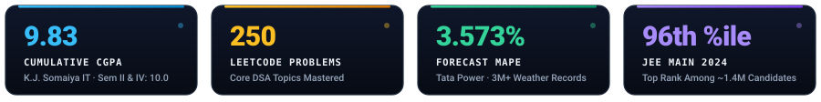

 

  

  

<table width="100%">
<tr>
<td width="50%" valign="top">

## 👨‍💻 About Me

- 🎓 B.Tech in Information Technology at **K. J. Somaiya Institute of Technology**
- 📈 CGPA: **9.83**
- 🧠 Solved **250+ LeetCode problems** across core DSA topics
- 🔭 Interested in Backend Development, Software Engineering, and Machine Learning
- 🌱 Currently learning: MERN Stack, System Design Fundamentals, ML Deployment, Cloud Technologies

</td>
<td width="50%" valign="top">

## 🌱 Currently Learning

- Building full-stack applications with the MERN Stack
- Strengthening Backend Development and REST API design
- Exploring System Design fundamentals
- Learning PostgreSQL and scalable database design
- Solving Data Structures & Algorithms regularly

</td>
</tr>
</table>

  

## Experience

<table width="100%">
<tr>
<td width="50%" valign="top">

### Machine Learning Intern — Tata Power
*Weather Prediction Project · June 2026 – Present*

- Built a day-ahead temperature forecasting pipeline over **3M+ historical weather records**, predicting all **96 daily 15-minute intervals** for power-scheduling applications.
- Engineered time-series features (lags, rolling statistics, 30-day climatology, diurnal anomalies) and used causal preprocessing to prevent future-data leakage.
- Evaluated multiple forecasting models and developed a final **Random Forest–Analogue ensemble**, reaching **3.573% MAPE** on a locked confirmation test spanning 48 quality-controlled (QC-clean) days.

</td>
<td width="50%" valign="top">

### Full-Stack Development Intern — India Meteorological Department (IMD)
*June 2026 – Present*

- Built an atmospheric research platform with **React, TypeScript, Flask, and MongoDB**, including JWT authentication, protected REST APIs, and role-based access control.
- Developed **7 Recharts visualizations** for atmospheric analysis, plus a Pandas-based CSV/XLSX ingestion pipeline with meteorological validation and data-quality reports.
- Integrated the **SondeHub v2 API** with thread-safe TTL caching and error handling; implemented balloon tracking, periodic updates, and historical sounding imports.

</td>
</tr>
</table>

  

## 🚀 Featured Projects

> 💡 *Explore live interactive demos and in-depth case studies on my [Portfolio Website](https://himesh-popat.vercel.app).*

<table width="100%">
<tr>
<td width="50%" valign="top">

### 🛒 Veloxa — B2B Wholesale Commerce Platform

> Wholesale order management platform built for wholesalers and retailers.

- User authentication and role-based access control
- Product management, inventory tracking, and shopping cart
- Order management with email notifications
- Responsive, secure backend design

**Tech:** Python • Flask • SQLAlchemy • SQLite • Bootstrap • Render

</td>
<td width="50%" valign="top">

### 👁 Color Vision Deficiency Detection & Simulation

> REST API-based application that detects and simulates types of color blindness.

- Real-time image processing with drag-and-drop interface
- Protanopia, Deuteranopia, and Tritanopia simulation
- Optimized NumPy-based pixel transformations

**Tech:** HTML • CSS • JavaScript • Flask • NumPy

</td>
</tr>
<tr>
<td width="50%" valign="top">

### 🩺 Diabetes Risk Prediction System

> ML application for predicting diabetes risk using healthcare datasets.

- Logistic Regression with SMOTE oversampling
- Cross-validation for robust evaluation
- Deployed via Streamlit
- Achieved **71.4%** accuracy

**Tech:** Python • Scikit-Learn • Streamlit

</td>
<td width="50%" valign="top">

### 🌐 Personal Portfolio & Interactive Showcase

> Modern, responsive developer portfolio showcasing engineering projects, interactive demos, and technical skills.

- Built with modern frontend architecture, component-driven design, and responsive layout
- Strict TypeScript type safety, optimal performance, and continuous deployment via Vercel

**Tech:** React 19 • TypeScript • Tailwind CSS • Vite • Vercel

</td>
</tr>
</table>

  

## 🛠 Tech Stack

<table width="100%">
<tr>
<td width="33%" valign="top">

**Languages**
 

</td>
<td width="33%" valign="top">

**Frontend**
 

</td>
<td width="34%" valign="top">

**Backend**
 
 

</td>
</tr>
<tr>
<td width="33%" valign="top">

**Databases**
 

</td>
<td width="33%" valign="top">

**Machine Learning**
 
    

</td>
<td width="34%" valign="top">

**Tools**
 

</td>
</tr>
</table>

  

## 🏆 Achievements

<table width="100%">
<tr>
<td width="100%" valign="top">

- 🎯 **96th Percentile in JEE Main 2024**, among approximately 1.4 million candidates.
- 🥇 Achieved a perfect **10.0 SGPA** in Semesters II and IV.
- 🚀 Qualified for **Smart India Hackathon (SIH) 2026 Round 2**, leading a six-member team to develop a full-stack platform for cultural heritage preservation.
- 💻 Solved **250+ problems on LeetCode**, covering various Data Structures and Algorithms topics.
- 🏅 Qualified and participated in the **AMD Online Hackathon**.
- 📊 Completed **Deloitte Data Analytics Job Simulation** through Forage, covering data analysis and forensic technology.
- 🎓 Completed **IIT Bombay Spoken Tutorial Certifications** in Python (100%) and Java (95%).

</td>
</tr>
</table>

  

## 📊 GitHub Analytics

  

## 📫 Let's Connect

  

Thanks for visiting!

Explore my [Portfolio Website](https://himesh-popat.vercel.app) or connect to collaborate on exciting projects.

